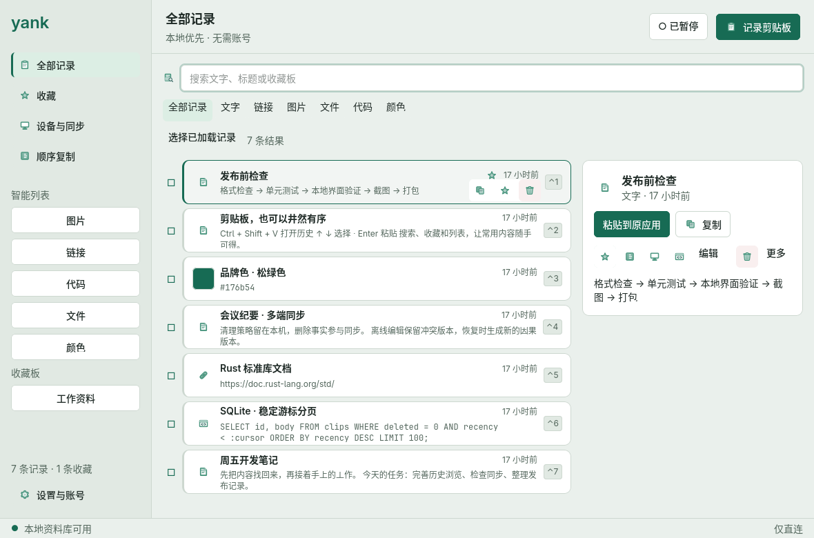
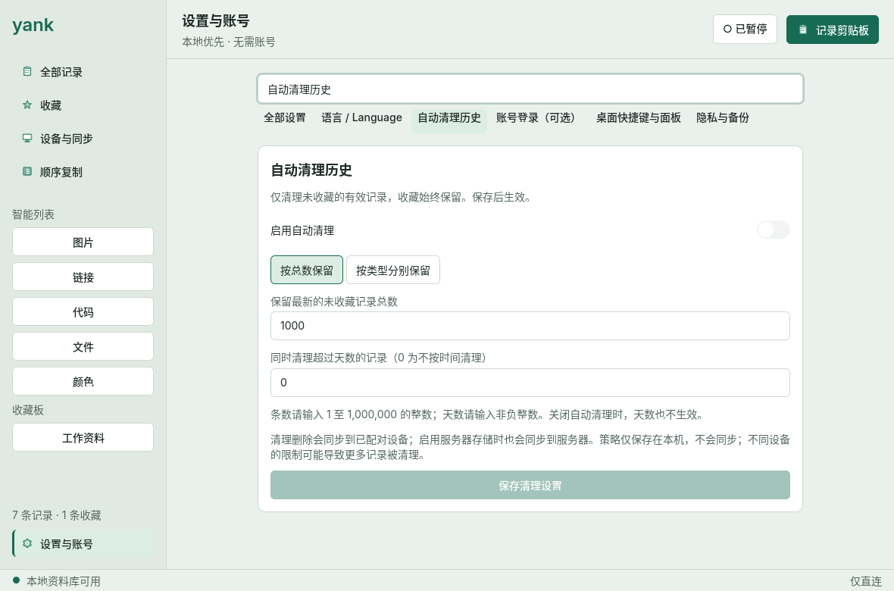
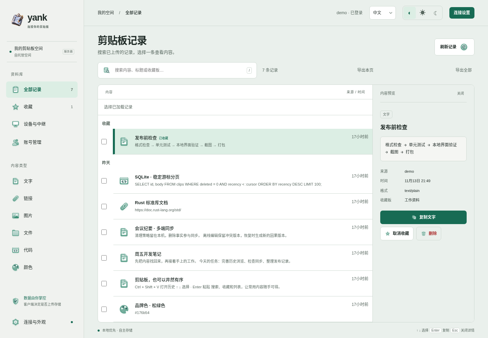

# Yank

本地优先的剪贴板工具，Rust + NSH 客户端，支持 Windows、macOS、Linux 和 Android；服务端提供可选账号存储、设备发现及加密中继。

不登录、不连接服务器，也可以记录、搜索、编辑与复制本地历史。登录不会自动上传；在客户端单独开启“上传并保存在服务端”后，历史和后续修改才会保存到账号空间。

## 客户端

- 文字、HTML/RTF、PNG、文件路径记录；搜索、收藏板、智能列表、Markdown/代码预览。
- 中英文界面、Kubai 图标；最近历史可选当天、近 1–5 天、本周或本月，按需加载更早内容，复制/粘贴成功后提前。
- 默认关闭的自动清理：总条数或按类型限额，可结合天数；收藏不删。清理产生同步删除，规则只属于本机。
- 顺序复制与桌面粘贴队列、自动收集、最多八张置顶悬浮卡片。
- 紧凑历史卡片、悬停操作、右键菜单与多选删除；详情先阅读，再按需编辑，草稿显式保存或放弃。
- 设置支持分组搜索、组合键录入和合并草稿保存；队列支持调整顺序、移除及撤销取出。
- 设备码或局域网发现配对，首次需要对端确认；可选择仅互通，或自行登录关联账号。
- 默认中继、仅直连、自动 NAT/中继回退；设备间走加密 QUIC + Protobuf。
- 默认关闭服务端上传；支持脱离服务器离线使用、隐私标记过滤、应用/内容排除、历史保留、每日备份和导入恢复。
- 桌面托盘、可配置全局快捷键、窗口位置/大小、浅深色外观、可选开机启动和校验和验证的自动更新。

桌面自动更新使用 NSH Updater，默认关闭，仅支持从发布归档解压的、带 `yank-portable.json` 标记的独立程序目录。开启后每日检查 GitHub 的 `latest.json`，下载并校验 SHA256，再替换整个程序目录，下次启动生效；请勿将个人文件放在程序目录。程序数据保存在独立用户数据目录中，不随更新替换。包管理器安装（deb/rpm/pacman、Homebrew、Scoop、WinGet 等）、系统目录及来源不明的安装禁用应用内更新，需通过原安装渠道升级；即使旧配置开启自动更新也不会绕过此限制。开发构建不替换自身，Android 仍使用发布页手动安装。GitHub 更新清单目前依赖 GitHub HTTPS 和仓库发布权限，尚未配置独立 Ed25519 发布签名。
- 客户端与管理页支持简体中文/English 即时切换，语言选择保存在本机。
- 自动清理可关闭，支持总体条目上限或按类型限额，可额外设置过期天数；收藏记录保留。清理删除会同步到已配对设备及已启用存储的服务端，规则本身仅在本机生效，详见 [一致性设计](docs/design/cleanup-consistency.md)。
- rutis 承载的可选 Ditto 网络适配器，见 [互通范围](docs/ditto-protocol.md)。

Linux 发布 `.deb` 和包含独立 client/server 二进制的 `.tar.gz`。依赖 GTK 4.14+ 和 GStreamer，建议 Ubuntu 24.04 或兼容发行版。Windows/macOS 包未签名，macOS 未公证。Android APK 当前为 debug 签名测试包，不用于商店分发；跨构建升级可能需要先备份再重装。

Android 采用前台手动捕获和复制，不承诺后台读取其他应用剪贴板。Wayland 上不能确认全局输入授权时只复制内容，提示用户手动粘贴。文件记录保存路径，本版不传输文件实体；只有本机实际捕获且内容未被改写的文件路径可写回，跨设备或导入的文件历史需在本机重新复制源文件。更多已实现/待完成项见 [能力清单](docs/ditto-client-capability-matrix.md)。

## 界面

以下为 Linux 原生客户端和服务端管理页的真实运行截图，使用隔离的演示数据库；中英文界面不会翻译用户自己的剪贴板内容。





深色与窄屏示例：[原生客户端](docs/screenshots/native-history-dark.png) · [管理页](docs/screenshots/server-history-dark.png) · [手机宽度](docs/screenshots/server-mobile-dark.png)。

管理页支持批量选择/删除，导出当前加载页或全部账号记录。全量导出使用一致读快照，包含有效记录、完整格式内容与智能列表；不是包含删除日志的数据库镜像。验收范围及未实现的小项见 [0.4.0 验收记录](docs/reviews/v0.4.0-local-verification.md)。

## 自托管

首次启动设置管理员用户名和至少八字节密码；已有账号不会被环境变量重置。

```bash
export YANK_ADMIN_USERNAME=admin
read -rsp 'Initial admin password: ' YANK_ADMIN_PASSWORD
export YANK_ADMIN_PASSWORD
cargo run -p yank-server -- --bind 127.0.0.1:7219 --db ./data/yank.sqlite3
```

打开 `http://127.0.0.1:7219`。管理员创建账号、重置其他用户密码；用户可修改自己的密码，更新密码会撤销该账号的全部会话。每个账号有独立的历史与设备发现范围。

```bash
docker run --rm \
  -p 7219:7219 -p 7220:7220 \
  -e YANK_ADMIN_USERNAME -e YANK_ADMIN_PASSWORD \
  -e YANK_PUBLIC_URL=https://yank.example.com \
  -e YANK_RELAY_URL=https://relay.example.com \
  -e YANK_COOKIE_SECURE=true \
  -v yank-data:/data ghcr.io/ca-x/yank:0.4.0
```

公网部署为 API 和中继配置反向代理/TLS，`YANK_RELAY_URL` 必须是客户端可达的地址。API 默认 7219/tcp，中继默认 7220/tcp。自动 NAT 地址发现可配置 `YANK_TLS_CERT`、`YANK_TLS_KEY`、`YANK_QUIC_BIND`（默认 7842/udp），并按需发布该 UDP 端口。`YANK_STORAGE_DISABLED=true` 只禁用持久化 API，不影响账号发现与中继。

备份 `YANK_DB` 账号数据库及其同名 `.users` 目录。例如 `yank.sqlite3` 对应 `yank.users/`。活动 SQLite 需使用一致的数据库备份，不能只拷贝 `.sqlite3` 而忽略 WAL。

设备中继只转发端到端加密内容；**可选服务端存储由服务端读取，不是对服务端端到端加密**。未登录设备可按精确设备码发现对方，仍需双方确认配对；不提供访客设备列表。

## 开发

Rust 1.97+，客户端与 CLI 固定同一个 NSH commit，详见 Cargo.toml。Ubuntu 24.04 构建依赖：

```bash
bash scripts/package-linux-deps.sh
cargo run -p yank-client
```

Protobuf 使用 Buf；不使用 JSON 或 Rust 专用序列化作为设备协议。

```bash
cargo install --locked protoc-gen-prost --version 0.5.0
buf lint
buf generate
cargo fmt --all --check
cargo check --locked --workspace --all-targets
cargo test --locked --workspace
cargo clippy --workspace --all-targets -- -D warnings
```

构建与打包：

```bash
cargo build --locked --release -p yank-client -p yank-server
python scripts/package-desktop.py --platform linux-x86_64
bash scripts/package-android.sh /path/to/pinned/nsh
```

Android 需 JDK 17、SDK 35、NDK 27 和相应 Rust Android target；固定 NSH CLI 的 runtime 与 app ABI 必须一致。协议/数据库/同意边界见 [设计契约](docs/design/redesign.md)，UI/UX 独立审核证据见 `docs/reviews/`。

MIT OR Apache-2.0，依赖与研究来源见 [THIRD_PARTY.md](THIRD_PARTY.md)。
